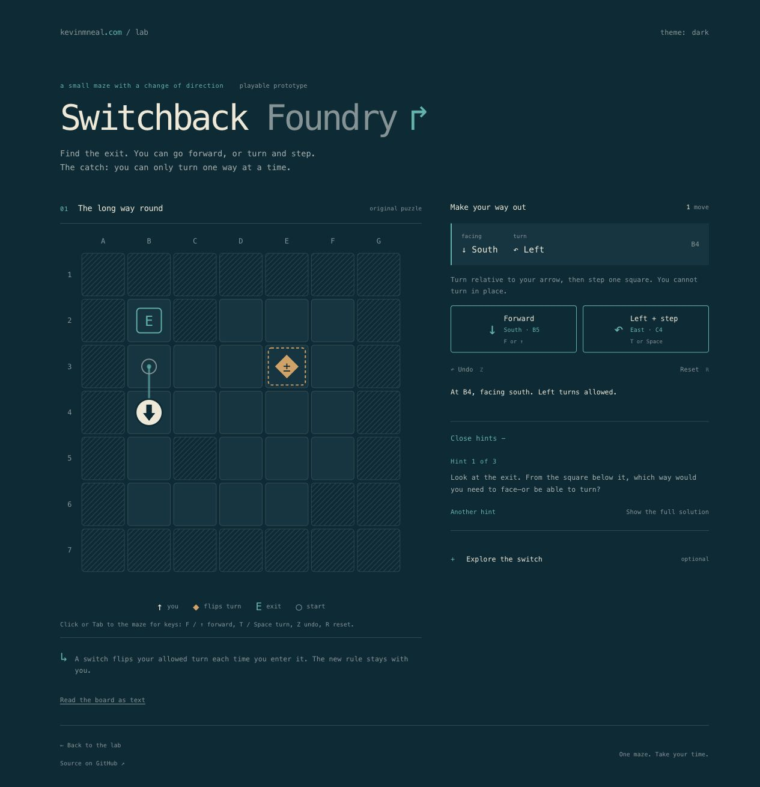

# Switchback Foundry

A small maze about how your way back can change.

[Play online](https://kevinmneal.com/lab/switchback/) · [More from the lab](https://kevinmneal.com/lab/)

Move forward, or turn and step. You can only turn one way, and stepping onto the switch changes that rule. Find your way out, ask for a gradual hint when you want one, then try a shorter route or predict what would happen if the switch became ordinary floor.

This is one curated puzzle and a playable prototype for human playtesting. The first successful route counts; the efficiency challenge and full solution are optional.



## Run locally

You need Python 3 and a modern browser. There are no dependencies to install or build step to run.

```sh
git clone https://github.com/kevinmneal/switchback-foundry.git
cd switchback-foundry
python3 -m http.server 8765 --bind 127.0.0.1 --directory dist
```

Open http://127.0.0.1:8765/. Serve over HTTP so the JavaScript modules load correctly. The app runs entirely in your browser, without accounts, analytics, or a server-side solver. Progress lasts for the current page session.

## Play

- Use the two movement buttons, or focus the maze and press F / Up for forward, T / Space for turn-and-step, Z to undo, and R to reset.
- **Need a nudge?** reveals one hint at a time. The optional walkthrough preserves your interrupted run.
- After escaping, **Try the route challenge** reveals the shortest-route target.
- **Explore the switch** asks for a prediction before you try the altered maze or request its result.

The important state includes your square, heading, and allowed turn direction. Returning to a square can therefore leave you with different possibilities.

## Development and checks

Use Node.js 22 or newer for the checks; no package installation is needed.

```sh
npm test
npm run check
```

The independent checker covers 600 restart states and 1,200 transitions, shortest-route counting, repeated switch entry, and the puzzle's return and route-choice properties. These checks establish the rules and structure, not human difficulty or enjoyment. Desktop, portrait, short-screen, and landscape browser layouts have been inspected; physical-device and spoken screen-reader testing remain outstanding.

To make one portable HTML file:

```sh
python3 scripts/build-preview.py /absolute/output/Switchback_Foundry.html
```

See [development notes](docs/DEVELOPMENT.md) for the rules, file layout, validation boundaries, and solution spoilers, and [the handoff](docs/HANDOFF.md) for the current project state.

## Website copy

This repository is the source of truth. The live puzzle is a versioned copy in [the homepage repository](https://github.com/kevinmneal/homepage). Its `scripts/sync-switchback.py` copies a committed `dist/` and records the source revision and file hashes. Change and test the puzzle here, then explicitly update the homepage copy; this repository does not deploy automatically.

The project was extracted from [the initial homepage release](https://github.com/kevinmneal/homepage/commit/2e1616dba8ffaee2f39c3c9c8766370a30530af7). The puzzle, model, and interaction logic were preserved during extraction; shared appearance assets are now local to this repository.

Created by Kevin M. Neal with assistance from coding agents.
